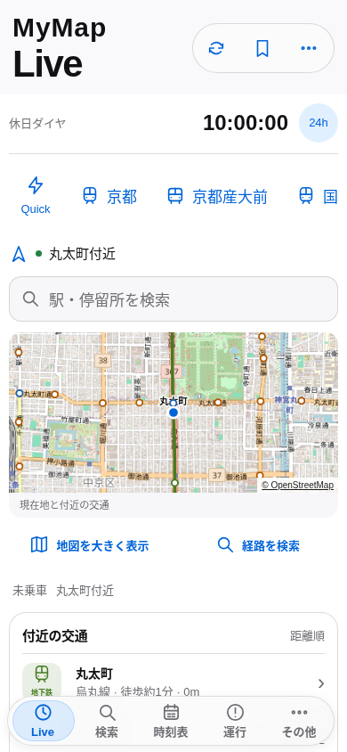

# Before / After 画面比較

Before: main `8f04791` / build `0e633053b133`。After: build `06ad19dcadc7`。390×844・Light・文字100%。交通/GPS/時計はfixtureで、実車の画像ではない。乗車表示のsource/遅れもテストデータ。変更が不要な既存画面は「維持」と記す。

全272状態の詳細座標・画像は `/workspace/artifacts/mymap-final-spec-2026-10-15/06ad19-coordinates`。集計は [coordinates-summary.json](coordinates-summary.json)。

|画面|Before|After|変更・維持|
|---|---|---|---|
|Live未乗車|[画像](before/now-home.png)|[画像](after/now-home.png)|検索入口から専用Live・時計・Quick Select・Mini Mapへ|
|日時|[画像](before/search-date.png)|[画像](after/search-date.png)|fit Sheet・取消/適用・始発終電|
|検索|[画像](before/search.png)|[画像](after/search.png)|出発/経由/到着・単一フォームを維持|
|候補|[画像](before/stop-picker.png)|[画像](after/stop-picker.png)|既存Fullscreen候補と保存/近くを維持|
|経由|[画像](before/search-via.png)|[画像](after/search-via.png)|滞在時間と経路再計算を維持|
|検索条件|[画像](before/search-filter.png)|[画像](after/search-filter.png)|交通機関/徒歩速度・近鉄条件の文脈表示|
|検索結果|[画像](before/search-results.png)|[画像](after/search-results.png)|前後便/早楽安を維持・source期限を検証|
|経路詳細|[画像](before/route-detail.png)|[画像](after/route-detail.png)|主要案内CTAを下部・画像保存をその他へ|
|経路途中駅|[画像](before/route-stops.png)|[画像](after/route-stops.png)|既存の途中駅と時刻を保持|
|烏丸線乗車|[画像](before/rail-ride.png)|[画像](after/rail-ride.png)|路線色と次駅/降車・文字拡大時のheader|
|全停車駅|[画像](before/rail-stops.png)|[画像](after/rail-stops.png)|既存Push・scroll/Backを維持|
|駅詳細|[画像](before/station-detail.png)|[画像](after/station-detail.png)|既存の時刻表/駅情報を維持|
|降車選択|[画像](before/destination-sheet.png)|[画像](after/destination-sheet.png)|既存Sheetと通知を維持|
|折り返し入口|[画像](before/foldback-home.png)|[画像](after/foldback-home.png)|既存2方式に次駅方式を追加|
|折り返し駅|[画像](before/foldback-station.png)|[画像](after/foldback-station.png)|同じ到着/遅れ/余裕計算を維持|
|折り返し列車|[画像](before/foldback-trains.png)|[画像](after/foldback-trains.png)|便識別と共通駅の照合|
|折り返し確認|[画像](before/foldback-confirm.png)|[画像](after/foldback-confirm.png)|移動/余裕/可否を保持|
|詳細地図|[画像](before/ride-map.png)|[画像](after/ride-map.png)|既存Fullscreen・viewport保存・fractional pinch|
|遅延|[画像](before/delay-analysis.png)|[画像](after/delay-analysis.png)|既存推定/観測/公式の区別を維持|
|列車位置|[画像](before/live-trains.png)|[画像](after/live-trains.png)|前方/反対列車の既存情報を維持|
|市バス乗車|[画像](before/bus-ride.png)|[画像](after/bus-ride.png)|事業者色・次停留所/降車を優先|
|全停留所|[画像](before/bus-stops.png)|[画像](after/bus-stops.png)|既存の全停留所Pushを維持|
|停留所詳細|[画像](before/bus-stop-detail.png)|[画像](after/bus-stop-detail.png)|系統/方面/接近・地図を維持|
|全接近|[画像](before/arrivals.png)|[画像](after/arrivals.png)|全系統/両方向・offline sourceを修正|
|時刻表Home|[画像](before/timetable-home.png)|[画像](after/timetable-home.png)|検索/保存/近く/路線の既存構成を維持|
|駅時刻表|[画像](before/station-timetable.png)|[画像](after/station-timetable.png)|曜日/方面/次便/始発・急行を維持|
|便詳細|[画像](before/timetable-trip.png)|[画像](after/timetable-trip.png)|公式停車時刻の既存表示を維持|
|運行|[画像](before/operations.png)|[画像](after/operations.png)|現在の移動・再検索・古いnormalをUnknownへ|
|運行詳細|[画像](before/operation-detail.png)|[画像](after/operation-detail.png)|既存Pushと公式sourceを維持|
|その他|[画像](before/settings.png)|[画像](after/settings.png)|既存設定にPrivacy/権限/時計を追加|
|定期券|[画像](before/settings-pass.png)|[画像](after/settings-pass.png)|既存の登録/運賃適用を維持|
|範囲設定|[画像](before/settings-distance.png)|[画像](after/settings-distance.png)|既存の実駅数の表示を維持|
|対応路線|[画像](before/settings-routes.png)|[画像](after/settings-routes.png)|既存交通機関と全対応路線を維持|
|情報と出典|[画像](before/settings-info.png)|[画像](after/settings-info.png)|既存出典・データ未取得説明を維持|
|近鉄乗車|[画像](before/kintetsu.png)|[画像](after/kintetsu.png)|赤橙の路線色・既存案内を維持|
|烏丸線/近鉄直通|[画像](before/through.png)|[画像](after/through.png)|単一Journey・竹田K/B境界を維持|
|京都バス/北3|[画像](before/kyotobus.png)|[画像](after/kyotobus.png)|青の事業者色・既存停留所を維持|

## 実地理のMini Map

上の画面座標試験は背景タイルが固定画像。次の画像だけは実OSMタイルを取得し、全タイルのnaturalWidthとURLを検証した。GPS/交通/時計はfixtureのまま。

## Motion途中の証拠

|状態|画像|
|---|---|
|Push途中|[画像](after/push-midpoint.png)|
|Pop途中|[画像](after/pop-midpoint.png)|
|30% Swipe（Light）|[画像](after/swipe-30-light.png)|
|30% Swipe（Dark）|[画像](after/swipe-30-dark.png)|
|Sheet drag|[画像](after/sheet-drag-65.png)|
|Quick Select finger tracking|[画像](after/live-quick-tracking-false.png)|
|Mini Map pinch途中|[画像](after/live-pinch-false.png)|
|次駅折り返し確認|[画像](after/foldback-next-false.png)|

Animationを途中で止めた画像と、pointer移動中に取得した画像を区別して自動操作する。物理iPhoneのSafari edge gestureやHapticの合格を示すものではない。

## 本番公開後の実画面（2026-10-16）

https://at5tram98-hash.github.io/kyoto-transit/ の実配信を390×844で操作した。API・GPS・時計・タイルのfixtureなし。上の固定feedによる37組と区別する。実車の乗車試験ではない。

|状態|画像|
|---|---|
|Live・実OSMタイル|[画像](production-live.png)|
|当日ダイヤの検索結果|[画像](production-results.png)|
|実際の別便Sheet|[画像](production-departures.png)|
|11:42発→11:49着へ変更|[画像](production-changed-journey.png)|
|reload後の選択便・全旅程|[画像](production-itinerary.png)|
|実旧PWAで新版の更新待機|[画像](production-update-waiting.png)|
|更新後の旅程保持|[画像](production-update-preserved.png)|
|更新後の全旅程|[画像](production-update-itinerary.png)|

[公開Browser原本](production-browser-report.json) / [旧→新PWA更新原本](production-update-report.json) / [公開・CI・版の記録](production-release.json) / [実API最終確認](production-report.json)。旧PWAの実更新は`0e633053b133`→`06ad19dcadc7`、前後のtripId一致を確認。実走・物理iPhoneの合格判定には使用しない。
