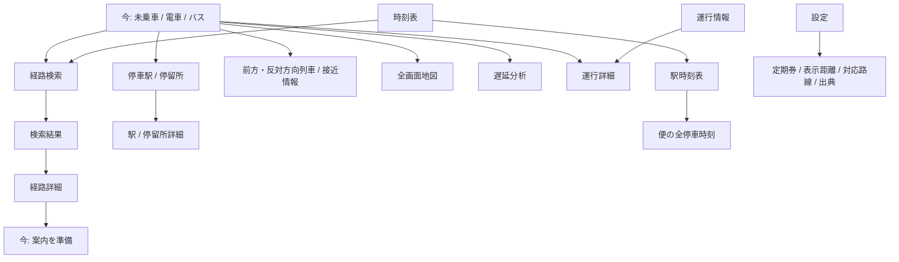

# MyMap 操作アーキテクチャ改修

最新版の基準：main `a2e20a4`。PDF WORK HANDOFF v1.1とUX全面改修指示を適用。データ取得・時刻表・乗車判定・既存路線・通知・定期券・PWAの仕組みは保持する。

## Before

4タブをhiddenで切り替える。今はHero→列車位置→全駅表→分析→地図→接近と縦に続く。未乗車時は検索DOMを今へ移動する。駅・地図・分析は共通dialog、時刻表の駅選択は一覧の置き換え、便詳細はdialog。タブ切替はwindowの先頭へ戻る。

## Navigation Map / 配置

| メイン | Push | Sheet | Full Screen |
|---|---|---|---|
| NowHome：未乗車、行き先入口、最近/保存、近くの便 | 検索→結果→経路詳細、近くの駅/停留所→駅詳細/時刻表、接近一覧 | 日時・検索条件、並び替え・短い選択 | 周辺地図 |
| RailRide：路線/種別/行先、次駅/英語/番号/到着まで、降車駅/残数、駅列、重要警告 | 停車駅→駅詳細、前方/反対列車、遅延分析、運行詳細 | 降車地点・通知、折り返しの短い選択 | 乗車地図 |
| BusRide：系統、次停留所/到着まで、降車地点/残数、小さな位置補助 | 全停留所→停留所詳細、接近/遅れ、運行詳細 | 降車地点・通知 | 乗車地図 |
| TimetableHome：駅/停留所検索と最近の入口 | 検索→結果→経路詳細、駅時刻表→便の全停車時刻 | 日時/条件 | 経路の地図 |
| OperationsHome：路線の運行状況一覧 | 各路線の運行詳細 | 短いフィルター | — |
| SettingsHome：項目一覧/スイッチ | 詳細設定・定期券・出典 | 短い選択 | — |

RailRide/BusRideは今のRootの交通状態であり、不要なBack段を加えない。タブは今・時刻表・運行情報・設定を維持。詳細は文脈に応じた独立Screenへ置く。

## Controller / Screen責務

`navigation-core.js`：純粋なTab別Stack、復元検証、操作判定。
`navigation.js`：Frame、History、Scroll/Focus復元、Cache、左端gestureとTabの橋渡し。
`navigation-motion.js`：共通Push/Pop、Crossfade、Hero更新、Sheet、Spring Return。
既存各UIモジュール：その機能のModel/StateとScreen描画。DOMをNowとTimetableの間で移動する方式を終了し、検索・結果・詳細の各ScreenをControllerで管理する。大きなdocument click if/elseの追加は行わない。

## History / URL

GitHub PagesのサブパスとOfflineを保つため `#/now/stops`、`#/now/station/K09`、`#/now/map`、`#/timetable/search`、`#/timetable/results`、`#/timetable/route` を使う。pushState/replaceState/popstateを共通Controllerで処理する。RootはStackの基点。Back/Swipe/Browser Backは同じ親へ戻す。Sheetは同じ履歴上のpresent/dismissとして処理し、閉じる際にScreenを二重Popしない。Tab別のStackは移動で消さない。乗車終了等で無効になったScreenだけ親へ戻す。

## State / Cache

各Screenが独立したネイティブscroll領域を持つ。入力、選択、展開、Focus、地図viewport、検索結果/選択と読み込み済みModelを保持する。セッション保存は型とサイズを検証し、HTML/認証情報を保存しない。新しい旅程の開始で明示的にホームへ戻しても検索の入力Modelは残す。

ScreenのDOM Cacheは最大5（Rootの4画面を除く）を基本とし、Stack上にある画面でも重いMapは非表示で画像取得/更新を止め、退避時のviewportを復元する。データ取得の所有者は既存のLoop/Sessionを共用し、GPS通知で接近取得を重複させない。

## Motion Map

| 意味 | Motion |
|---|---|
| Push / Pop | 320–360ms、子100%↔0、親0↔-25%、薄い左shadow |
| Swipe | 左端24px、水平意図を判定後に指と1:1。親も追従。33%または速度で確定 |
| Cancel | 短いSpring Return、履歴/入力は変更しない |
| Tab | 同列の短いCrossfade。Pushと区別 |
| Present / Dismiss | Sheetを下から移動。drag/velocity/backdropの追従 |
| Hero | 駅名・番号・countdown・残数の変更箇所だけ200–320msで更新 |
| Reduce Motion | 指追従は維持、自動移動は短いFade中心。文脈はタイトル/Backで明示 |

## Focus / Keyboard / Accessibility

Push先タイトル/領域へFocus、Pop時に元の操作対象へ戻す。Sheetはnative dialogでfocus trap。44px、色＋文字、aria-current、Dynamic Type 100/150/200%、Dark/High Contrastを確認。visualViewport/safe-areaに対応し、Keyboard時にTab Bar/CTAが浮かないようにする。scroll physicsはブラウザーの慣性をそのまま使う。

## 変更対象・検証

既存 `vnext`、`vnext-view`、`context-sheet`、`route-search-ui`、`route-map`、`timetable-ui`、運行/設定とCSSを適切な責務に整理する。データ契約や既存APIを簡略化しない。

390×844の明暗・文字100/150/200・Reduce Motion・GPS ON/OFFでFlow A–Fを実際のChromium/WebKitで確認。低速/30%キャンセル/50%確定/Flick/PointerCancel/縦scroll/地図/Sheet/Tabの競合を確認。履歴、フォーム、選択、地図viewport、スクロール復元と非表示時の通信/DOM/Animation抑制を測る。PWA更新/Offline/復元の既存回帰を保持し、静止画に加えてPush/Swipe/Sheet途中の画像を残す。

実機Safari/PWAでのOS edge gestureや触覚の完全な再現はブラウザー自動試験だけで断言しない。WebKitで競合時のPointerCancelとpopstateを検証し、残る実機固有事項を明示する。

## 実装された Navigation Map

四つのタブのStackを保持する。同じタブをもう一度押す操作は、そのタブのホームへ戻る。タブは親画面にせず、現在タブの履歴をRootから構成し直す。旅程選択・案内終了では終了したフローの履歴を巻き戻し、ブラウザーBackで古い選択画面を誤って再開しない。

検索入力DOMを未乗車のRootへ移動する方式を削除した。既存フォームは検索Screenの所有物として再利用する。検索結果と経路詳細は個別Frameを作成し、検索世代ごとのModelを最大5件保持する。戻る・タブ復帰・再読み込みで入力と結果を復元する。既存時刻表もBoard/Tripの所有者を分離し、再読み込み時は選択した停留所と便を復元する。

DOM Frameは最大5、各タブの深さは最大8、UI保存は最大40項目、セッション保存は500KB以内。地図は旅程単位でpan/zoomを保持し、表示している画面だけを更新する。停車表は新しいModelの取得時とそのScreenの表示時に更新し、非表示の全駅表をGPSごとに作り直さない。

## 実装ファイル

| 責務 | ファイル |
|---|---|
| Stackと復元検証 | `public/js/navigation-core.js` |
| History、Frame、Cache、Gesture、Focus | `public/js/navigation.js` |
| 共通Motion、Hero、接近行の更新 | `public/js/navigation-motion.js`, `public/js/view-rendering.js` |
| 今の各詳細Screen | `public/js/now-navigation.js`, `public/js/vnext-view.js`, `public/js/context-sheet.js` |
| 検索、結果、経路詳細 | `public/js/route-search-ui.js` |
| 駅時刻表、便詳細、運行詳細 | `public/js/timetable-ui.js` |
| 設定詳細 | `public/js/vnext-network-view.js` |
| 地図viewportとgesture競合 | `public/js/route-map.js` |
| 統合と視覚構造 | `public/js/vnext.js`, `public/index.html`, `public/vnext-navigation.css`, `public/route-search.css` |
| 回帰試験 | `tests/navigation.test.js`, `scripts/browser-smoke.mjs`, `scripts/pwa-smoke.mjs` |

## 検証の限界

交通情報とレイアウトの回帰試験は固定の上流データを使用する。ソフトウェアキーボードはvisualViewport縮小のエミュレーション、Standaloneは表示モードのエミュレーションであり、実機iPhoneを操作したという意味ではない。PWAの更新・Offlineは実際のService WorkerとHTTP通信で確認する。

実機SafariのOS edge gesture、実際のソフトウェアキーボード、VoiceOverの読み上げ・触覚は実機での追加確認が必要。OSがgestureを取得した場合のPointerCancelとHistory復帰はブラウザー試験の対象とする。

北3の本番接近API・鉄道接近の測定データ・確認済みの道路形状の取得には、前回からの上流/Worker設定の課題が残る。この改修では交通データの取得契約を変更せず、未取得・推定・古いデータを区別して案内する。運行データの実測精度をUI回帰試験の成功だけで保証しない。
